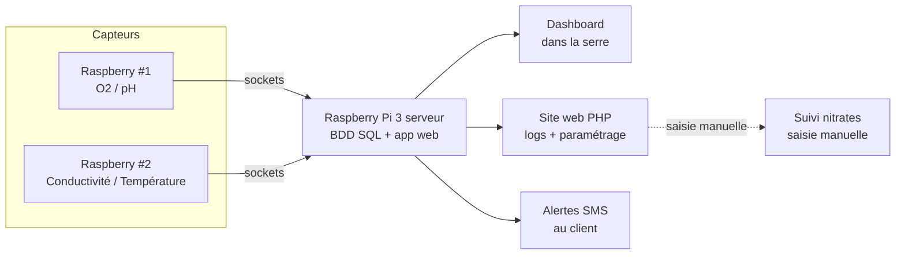

# 🌱 Projet BTS - Récolte de données de capteurs sur une ferme Aquaponique

> _Projet de BTS (promotion 2021) — un projet réel, avec un vrai client_

## 📋 Vue d'ensemble

|               |                                                                      |
| ------------- | -------------------------------------------------------------------- |
| **Équipe**    | 5 personnes                                                          |
| **Type**      | Projet réel avec client                                              |
| **Formation** | BTS, promotion 2021                                                  |
| **Durée**     | 6 mois, pendant les cours d'informatique                             |
| **Objectif**  | Superviser un système aquaponique via capteurs, dashboard et alertes |

## 🎯 Contexte

Notre partenaire professionnel pour ce projet était l'association **Emmaüs**, basée à Lespinassière dans l'Aude. Cette association est un chantier d'insertion accueillant des détenus en fin de longue peine.

À travers l'exploitation d'une ferme agro-écologique, l'association offrait un travail rémunéré, un logement et un accompagnement social aux personnes en réinsertion, afin qu'elles reconstruisent au mieux leurs liens familiaux et sociaux et qu'elles définissent leur nouveau « projet de vie ».

L'association venait de terminer la construction d'une serre. Celle-ci est équipée d'un réseau électrique classique ainsi que de fenêtres permettant de la ventiler au besoin. À côté de la serre, ils ont construit un bassin pour l'élevage de truites arc-en-ciel ainsi qu'un local technique enterré qui accueille les pompes pour la circulation de l'eau.

À noter : le système d'aquaponie existait déjà quand nous sommes arrivés — bassin, serre et circulation d'eau fonctionnaient. Notre mission n'était pas de le construire, mais de **le rendre observable** : ajouter les capteurs, le dashboard et les alertes SMS pour mesurer en continu les taux de l'eau.

## 💧 Qu'est-ce que l'aquaponie ?

L'aquaponie est une technique de culture qui consiste à recréer un écosystème miniature dans lequel les déjections des poissons servent d'engrais naturel pour, par exemple, des plantes. L'eau circule en circuit fermé et est entièrement recyclée.

### Quel est l'impact de l'aquaponie ?

L'aquaponie étant un système de culture 100 % naturel, elle a la particularité de n'utiliser aucun engrais artificiel ni pesticide. Bactéries, poissons et végétaux cohabitent dans un système vertueux, où chacun aide l'autre à se développer et dans lequel tout se transforme et rien ne se perd.

Grâce à ce système, il faut dix fois moins d'eau qu'en aquaculture.

C'est pourquoi il nous a semblé nécessaire d'automatiser les mesures de la qualité de l'eau afin de simplifier le travail des personnes en réinsertion, tout en créant une interface de gestion web pour piloter le système d'aquaponie.

## 🥅 Objectifs du projet

Le but de ce projet était de simplifier le travail des personnes en réinsertion en automatisant les mesures de qualité de l'eau (oxygène, pH, conductivité et température), combinées avec une interface de gestion web et un affichage dans la serre afin de visualiser et contrôler le système.

**Objectifs principaux :**

- **Application web** : mettre en œuvre un site design, responsive et intuitif pour permettre la visualisation des mesures ainsi que le contrôle des paramètres (seuils à ne pas dépasser).
- **Base de données** : mettre en œuvre une base de données pour enregistrer les mesures de qualité de l'eau ainsi que les différents paramètres relatifs au système.
- **Gestion des capteurs** : permettre l'acquisition des mesures pendant un intervalle de temps défini et envoyer ces informations à la base de données.
- **Gestion des alertes SMS** : envoyer une alerte SMS au client en cas de dépassement des seuils d'alerte fixés via l'application web.

## 🛠️ Matériel imposé

Ce projet nécessitait l'utilisation d'un matériel conséquent, notamment pour la partie capteurs. Pour répondre à ces exigences, le matériel suivant a été choisi :

- **Capteurs** : ils ont servi à collecter les données de qualité de l'eau à différents endroits. Ils sont reliés au serveur (Raspberry) afin de les stocker dans la base de données.
- **Raspberry Pi 3** : un Raspberry Pi 3 faisait office de serveur et accueillait l'application web et la base de données (SQL). Il servait aussi de serveur hôte pour le programme de gestion centrale (gestion des données, transmission/réception). Deux autres Raspberry Pi servaient à relever les données et les envoyer au serveur.
- **Boîtiers pour Raspberry Pi** : ils ont protégé le matériel électronique de l'eau et permis de créer une structure conforme.
- **Module SIM** : ce module permettait de gérer l'envoi de SMS en cas de dépassement de seuil.

## ⚠️ Contraintes techniques

Chaque étudiant devait mettre en œuvre, en plus du matériel, des outils logiciels afin de réaliser sa partie du projet, sur une durée d'environ 5 mois.

Le hic : dans le cahier des charges, l'association demandait la mesure des **nitrates**, pour évaluer la qualité de l'eau et la santé des poissons. Or, ce type de capteur est très onéreux ; nous avons décidé de ne pas l'intégrer au projet de cette année.

Notre solution : plutôt que d'abandonner cette mesure, nous avons intégré dans l'application web **une page entièrement dédiée aux nitrates**, qui permettait aux personnes en réinsertion de saisir la valeur manuellement et d'obtenir un suivi et un historique des mesures. Le besoin du client restait couvert, sans capteur hors de prix.

Autre contrainte imposée : l'application web devait être réalisée avec les langages **PHP, HTML, JS et CSS**, et hébergée sur le Raspberry Pi avec la base de données.

## 💰 Budget matériel

| Élément           | Nombre | Prix unitaire | Prix total   |
| ----------------- | ------ | ------------- | ------------ |
| Raspberry Pi 3    | 3      | 30,00 €       | 90,00 €      |
| Module SIM        | 1      | 60,00 €       | 60,00 €      |
| Écran             | 1      | 0,00 €        | 0,00 €       |
| Switch mini Cisco | 1      | 30,00 €       | 30,00 €      |
| Boîtier           | 3      | 96,84 €       | 290,52 €     |
| Câbles            | ?      | 0,00 €        | 0,00 €       |
| **Total**         |        |               | **470,52 €** |

## 👥 Répartition des tâches

### 🧠 Moi — Cœur du système

- Réception des données des 2 Raspberry capteurs (via sockets)
- Dashboard temps réel affiché dans la serre
- Installation et configuration du Raspberry principal

### 🌐 Geoffrey — Site web

- Site web en PHP
- Visualisation des logs
- Paramétrage du système

### 📡 Jean & Alexandre — Capteurs

- 2 Raspberry dédiés aux mesures, reliés au Raspberry principal via sockets :
    - **Raspberry #1** : Oxygène, pH
    - **Raspberry #2** : Conductivité, Température
- Envoi des mesures au Raspberry principal

### 📱 Sohayb (aka Soso) — Alertes

- Envoi de SMS sur le téléphone du client en cas de problème détecté

## 🏗️ Architecture du système

